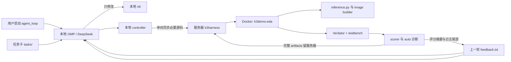

# RTL Harness 工程架构说明

本页解释这个项目为何这样拆分、哪些目录由谁负责、以及一次自动迭代的数据流。日常命令请看
[使用说明](使用说明.md)。

## 设计目标

- `reference.py` 是唯一浮点 golden source。
- 本地 OMP/DeepSeek 负责阅读任务、修改 RTL 和理解反馈。
- 服务器负责 Python reference、image 生成、Verilator 仿真、评分和诊断。
- 大型仿真产物留在服务器；本机只接收足够让 AI 下一轮定位的限长文本反馈。
- 本地 `RTLharness/` 是唯一源码，服务器副本可被下一次同步覆盖。

## 一次迭代的数据流



## 机器与路径

| 位置 | 路径 | 角色 |
| --- | --- | --- |
| 本地 canonical harness | `/Users/chenzikang/code/work/RTLharness` | 唯一可编辑源码、任务卡、AI 日志、紧凑反馈 |
| 本地 canonical reference | `/Users/chenzikang/code/work/k3demo/reference.py` | 浮点 golden 来源 |
| 服务器执行副本 | `/home/txjg7-2/ic-project/k3harness` | 每轮同步后的可丢弃执行目录 |
| Docker 容器 | `k3demo-eda` | EDA/Python 执行环境 |
| 容器内路径 | `/work/k3harness` | Docker 中对应服务器执行副本 |

## 目录职责

| 路径 | 维护者 | 内容与规则 |
| --- | --- | --- |
| `rtl/` | DeepSeek / 用户 | 候选 RTL；当前任务允许 AI 修改的主要目录 |
| `tb/` | 用户 / harness 契约 | 测试平台；当前修复任务不允许 AI 修改 |
| `tasks/` | 用户 | 任务目标、范围和验收条件；每次 agent 启动时读入 |
| `harness/` | harness | controller、容器内 run、诊断调度；不要由 AI 修改 |
| `scripts/` | 用户调用的入口 | 本地到服务器的上传、状态、取消与诊断 |
| `tools/standalone_rtl/` | 验证基础设施 | image 生成、评分与诊断工具；每轮同步到服务器 |
| `runs/` | 自动生成 | 单次 run、带唯一 session-id 的 AI 回合快照和紧凑反馈；不提交 Git |
| `reports/` | 自动生成 | 每轮变更和评分汇总；不提交 Git |
| `docs/` | 用户 / harness | 使用说明、架构说明、RTL 契约资料 |

## 同步与数据量控制

`scripts/remote_round.sh` 从本地单向同步以下必要内容：

- canonical `reference.py`
- `rtl/`、`tb/`
- `tools/standalone_rtl/`
- `harness/run.py`、`harness/diagnose.sh`、`harness.toml`

服务器会产生 image、golden NPZ、编译目录、memory dump、仿真日志和诊断日志。这些完整
artifacts 始终保存在服务器的 `runs/<run-id>/`。脚本只把评分摘要和各关键日志末尾拼成
本地 `feedback.txt`，以降低回传量。

## 调度层次

```text
agent_loop.py                 本地总控制器：调用 OMP、保存 diff、决定验证范围
└── remote_round.sh           单次远程验证入口：同步、启动 Docker、取回紧凑反馈
    └── harness/run.py        容器内：reference → image → Verilator → scorer
        └── harness/diagnose.sh  失败后：route audit → snapshot compare
```

`remote_status.sh --follow` 是人工监控工具，不能由 AI 调用；它会无限跟随日志。AI 只能运行
会自行结束的有限命令，验证由 controller 发起。

每次新启动的 agent 还会从同一份 `reports/<task>/progress.md` 自动提炼两层交接上下文：
最近最多 3 轮的“代码修改 + 验证摘要”，以及所有历史轮次的极简索引（修改文件、关键评分、
是否通过）。它同时读取当前 `rtl/`，因此后续 session 从累计代码状态继续，不会重新回到
baseline，也不会把大量旧 diff 注入 prompt。

同一份 `progress.md` 还是人工审计记录：每轮的结构化验证结论后，会附上该轮
`agent.log` 的完整可见输出。长日志不会回灌给下一轮 agent；controller 只提炼最近轮次的
结构化交接和全历史极简索引，以避免上下文膨胀。

## 多 token 的前缀策略

当前 RTL 有 state、卷积 history 和 MLA KV cache，单独运行一个出错 token 无法重现真实路径。
因此使用“从 pos0 开始的最短因果前缀”：已知首错 pos2 时跑 3 token。通过后再回归完整序列；
新首错在 posN 时下一轮跑 N+1 token。这兼顾定位速度和状态正确性。

## 发生异常时的边界

- 先看本地 `agent.log`：AI 是否正在分析、执行有限命令或已经修改 RTL。
- 再看 `remote_status.sh`：服务器是否实际运行。
- 终止本地 controller 后，若远端仍为 `running`，使用 `remote_cancel.sh`，不要停止整个 Docker
  容器。
- 已知问题与处理原则追加到根目录 [questionAndsolution.md](../questionAndsolution.md)。
